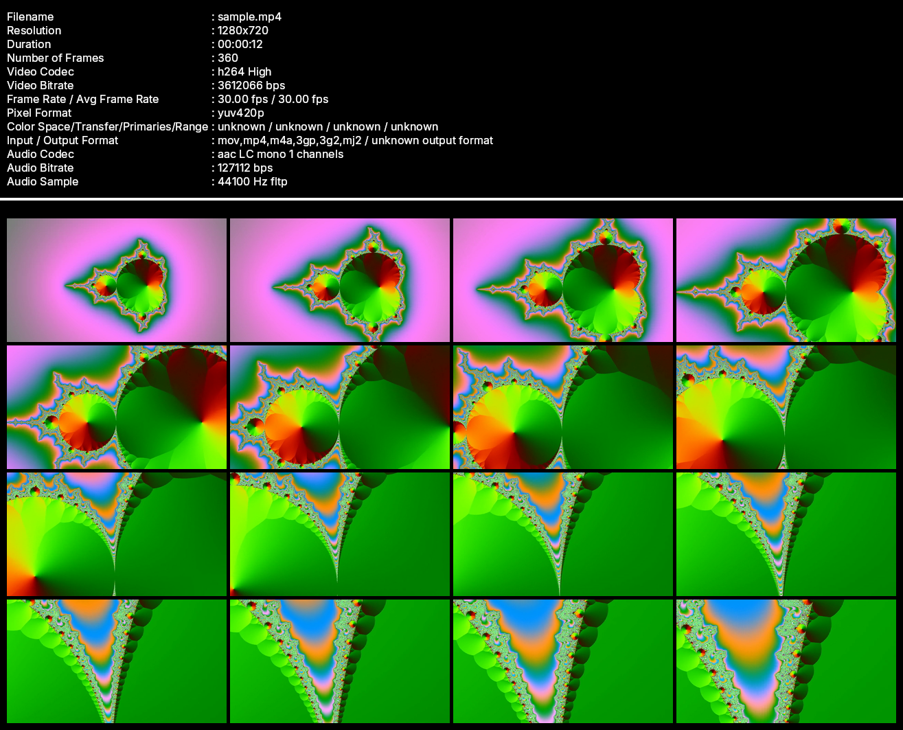

# osheet_cpp

C++23 project that using FFMPEG + Skia libraries to create video contact sheet.

- [osheet\_cpp](#osheet_cpp)
  - [Features](#features)
  - [Setup](#setup)
    - [Prebuilt Binaries](#prebuilt-binaries)
    - [Manual Build](#manual-build)
      - [Prerequisites](#prerequisites)
      - [Build Instructions](#build-instructions)
  - [Usage](#usage)
  - [CLI Arguments](#cli-arguments)
  - [Test Output](#test-output)


## Features

- Single executable. FFMPEG and Skia is statically linked to, so no external FFMPEG executable. The executable size is small too. Normally ffmpeg exec size is ~180 MB. This project's exec size is ~30 MB
- No temporary files. Frames are decoded and encoded in memory.
- Frame scaling uses FFmpeg swscale with Lanczos. Tiles are placed on the sheet with Skia's Catmull-Rom resampling. Output is PNG.
- Configurable arguments as [CLI arguments](#cli-arguments).
- Using Google's Skia ([google/skia](https://github.com/google/skia)) draws the text, the separator line and the tiles.

## Setup

### Prebuilt Binaries

- You can download prebuild binaries from [releases](https://github.com/alpertunga-bile/osheet_cpp/releases)

### Manual Build

#### Prerequisites

- C++23 compiler: GCC >= 12, Clang >= 13 or MSVC >= 19.38
- [CMake](https://cmake.org/) >= 3.26
- [Ninja](https://ninja-build.org/)
- [vcpkg](https://github.com/microsoft/vcpkg), cloned and bootstrapped, with `VCPKG_ROOT` pointing at it
- Tools that vcpkg needs to build Skia and FFmpeg:
  - Linux: `sudo apt-get install ninja-build nasm pkg-config autoconf autoconf-archive automake libtool gperf`
  - macOS: `brew install ninja nasm autoconf automake libtool pkg-config`
  - Windows: Visual Studio with the C++ workload, run from a "x64 Native Tools" prompt

#### Build Instructions

1. Set `VCPKG_ROOT`

```bash
export VCPKG_ROOT="$HOME/vcpkg"   # your vcpkg path
```

```powershell
$env:VCPKG_ROOT = "C:\vcpkg"      # your vcpkg path
```

2. Configure CMake 

- possible $triplet values are:
  - x64-linux
  - x64-windows-static
  - arm64-osx

```bash
cmake -B build -G Ninja -DCMAKE_BUILD_TYPE=Release -DVCPKG_ROOT="$VCPKG_ROOT" -DVCPKG_TARGET_TRIPLET=$triplet
```

3. Build with CMake

```bash
cmake --build build
```

## Usage

```bash
# defaults: 4x4 grid, 320 px tiles, writes sheet.png
./osheet_cpp -i movie.mkv

# 3 rows x 5 columns, 480 px tiles, custom output
./osheet_cpp -i movie.mkv -r 3 -c 5 -tw 480 -o movie_sheet.png

# other font from a font folder
./osheet_cpp -i movie.mkv --font Inter --font_dir ./fonts
```

## CLI Arguments

```bash
❯ ./build/osheet_cpp --help               
Usage: osheet_cpp [--help] [--version] --input VAR [--font VAR] [--font_dir VAR] [--font_size VAR] [--rows VAR] [--cols VAR] [--tile_w VAR] [--gap VAR] [--margin VAR] [--sep_gap VAR] [--output VAR]

Optional arguments:
  -h, --help        shows help message and exits 
  -v, --version     prints version information and exits 
  -i, --input       specify the input video file [required]
  -f, --font        Font style for the metadata [nargs=0..1] [default: "Kode"]
  -fd, --font_dir   Directory that contains the font style [nargs=0..1] [default: "fonts"]
  -fs, --font_size  Size of the font style for the metadata [nargs=0..1] [default: 16]
  -r, --rows        Total tile rows in the output [nargs=0..1] [default: 4]
  -c, --cols        Total tile columns in the output [nargs=0..1] [default: 4]
  -tw, --tile_w     Width of one tile [nargs=0..1] [default: 320]
  -g, --gap         Spacing between tiles [nargs=0..1] [default: 5]
  -m, --margin      Extra space between text and tiles [nargs=0..1] [default: 10]
  -sg, --sep_gap    Extra space between text and tiles [nargs=0..1] [default: 8]
  -o, --output      Output file [nargs=0..1] [default: "sheet.png"]
```

## Test Output

```bash
❯ ./build/osheet_cpp -i samples/sample.mp4 --font Inter

                        _/                              _/
                       _/                              _/
    _/_/      _/_/_/  _/_/_/      _/_/      _/_/    _/_/_/_/    _/_/_/  _/_/_/    _/_/_/
 _/    _/  _/_/      _/    _/  _/_/_/_/  _/_/_/_/    _/      _/        _/    _/  _/    _/
_/    _/      _/_/  _/    _/  _/        _/          _/      _/        _/    _/  _/    _/
 _/_/    _/_/_/    _/    _/    _/_/_/    _/_/_/      _/_/    _/_/_/  _/_/_/    _/_/_/
                                                                    _/        _/
                                                                   _/        _/

[■■■■■■■■■■■■■■■■■■■■■■■■■■■■■■■■■■■■■■■■■■■■■■■■■■ ] 100% ✔ Extracting tiles is completed                                   
✔ Metadata values are collected                             
The sheet.png file is created successfully

#----------------------------- Metadata -----------------------------#
Filename                             : sample.mp4
Resolution                           : 320x240
Duration                             : 00:00:04
Number of Frames                     : 60
Video Codec                          : h264 High
Video Bitrate                        : 36062 bps
Frame Rate / Avg Frame Rate          : 15.00 fps / 15.00 fps
Pixel Format                         : yuv420p
Color Space/Transfer/Primaries/Range : unknown / unknown / unknown / unknown
Input / Output Format                : mov,mp4,m4a,3gp,3g2,mj2 / unknown output format
Audio Codec                          : aac LC mono 1 channels
Audio Bitrate                        : 64591 bps
Audio Sample                         : 44100 Hz fltp
```

